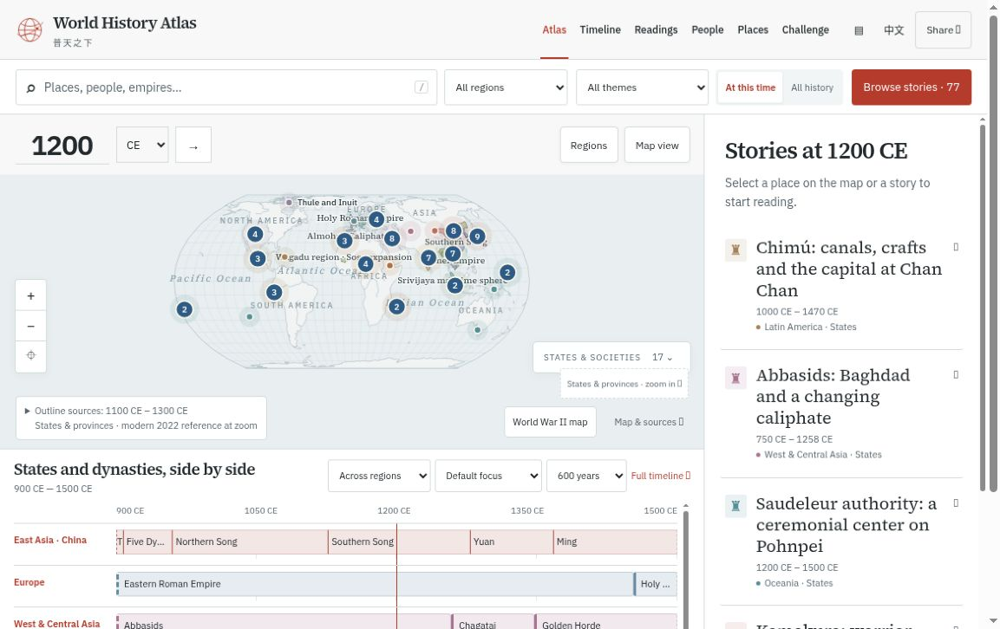

# World History Atlas · 普天之下

**把故事放回当时的世界。 · Put each story back in its world.**

An English–Chinese atlas for exploring what was happening in different parts of the world at the same time. Follow a person, place or story through maps, timelines and guided readings.

[**Explore the live atlas →**](https://world-history-atlas-guide.web.app/) · [简体中文](README_ZH.md) · [Sources & credits](ACKNOWLEDGEMENTS.md) · [Contribute](CONTRIBUTING.md)

[](https://world-history-atlas-guide.web.app/)

*Live interface, 11 November 2026. A light, map-first layout with red accents, readable story cards and regional timelines kept alongside the map.*

## Explore

- **See the wider world.** Choose a year, filter with map story lenses or `✦ Surprise`, and compare states, dynasties and concurrent turning points across the globe.
- **Follow human stories.** Browse people and places, trace multi-stop biographical arcs on the map, and hover concurrent stories to see cross-globe tethers.
- **Read in English or Chinese.** Take a short guided journey—from Ice Age camps and first monuments to medieval ocean travellers—or explore longer chaptered courses.
- **Look at the evidence.** Selected portraits, objects and documents carry image dates, source links and individual rights notices, plus an interactive History & Artifact Detective challenge.
- **Keep your own notebook.** Save entries and notes in your browser, then export them.

Coverage is selective and growing. Historical maps have different dates and limits; an empty area does not mean an absence of people or history.

## Development update · November 2026

**Updated November 2026: V18 / 0.24.0.** The collection contains **2,107 historical entries, 290 biographies and 106 guided readings** (including **10 cross-regional journeys** and **14 longer chaptered courses**). Its **605 credited images illustrate 1,081 entries (51.3%)**, crossing the half-collection visual milestone with image inspection, side-by-side comparison, **112 source-verified China event reviews**, **316 narrative prose refinements**, and 22 guided visual studies. Deep Origins entries populate `13,000–3,000 BCE` across six world regions while keeping state/dynasty timeline bars anchored from `3200 BCE`.

**Milestone reached:** meaningful, source-credited open-access images now accompany more than half of all entries (`1,081 / 2,107`, target `1,054`). [Verified release](docs/V18_RELEASE_1025.md) · [Coverage ledger](dist/data/visual-coverage-v18.json) · [Development record](docs/V18_VISUAL_EXPANSION.md).

Firebase is the primary live destination. Older [GitHub Pages](https://haitaowu12.github.io/world-history-atlas/) and GPT Site links may show earlier versions. GitHub Actions are paused through November 2026; do not dispatch or retry workflows before December.

## Why I built this

I started this while telling my daughter history stories. I wanted to show what life was like then and what was happening elsewhere at the same time, in both English and Chinese, so she could explore the wider world while staying connected to her Chinese heritage.

[Jiangshan Map / 江山时序](https://github.com/DeanChensj/jiangshan-map), by DeanChensj and contributors, helped turn that idea into something I could build. With help from OpenAI Codex, I made this atlas for other parents, learners and people who enjoy putting history in perspective.

Tony Wu

## Sources and acknowledgements

Thank you to **DeanChensj and the Jiangshan Map contributors**. Their work is both an inspiration and a source of attributed narratives, translations, place records and chronicles adapted in this project. World History Atlas is independently maintained; please also explore [Jiangshan's original atlas](https://deanchen.me/jiangshan-map/).

[Sources & credits](ACKNOWLEDGEMENTS.md) document the projects, mapmakers, data providers and institutions behind the atlas. Historical corrections and perspectives from different regions are welcome.

## Run locally

Use Node.js 22 or newer and Python 3. No dependency installation or application build is needed.

```sh
git clone https://github.com/haitaowu12/world-history-atlas.git
cd world-history-atlas
npm run serve
```

Open http://127.0.0.1:8080. Run `npm run check` to validate the application and data. The committed `dist/` directory is the static application.

## Contribute and reuse

[Open an issue](https://github.com/haitaowu12/world-history-atlas/issues) for a correction, translation suggestion or usability problem. Include an entry link or title and a supporting source for historical corrections. Read the [contribution guide](CONTRIBUTING.md) and [data policy](docs/DATA_POLICY.md) before changing records.

Original application code and documentation use [MIT](LICENSE); original historical summaries and teaching material use [CC BY 4.0](docs/CONTENT_LICENSE.md). Imported material and dependencies retain their own notices. Images have [file-specific credits and rights](dist/assets/history-media/NOTICE.md). This is a mixed-license collection: neither MIT nor CC BY covers every file.

Built by [Tony Wu](https://tony-wu-home.web.app/) · [More projects](https://tony-wu-home.web.app/#work)
