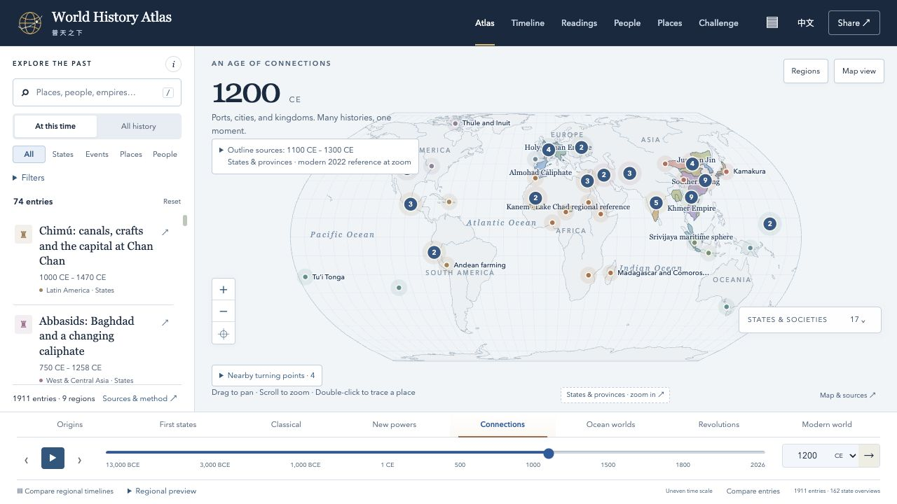

# World History Atlas · 普天之下

**把故事放回当时的世界。 · Put each story back in its world.**

[Explore the atlas](https://world-history-atlas-tony.techiesea.chatgpt.site) · [GitHub Pages](https://haitaowu12.github.io/world-history-atlas/) · [简体中文](README_ZH.md) · [Acknowledgements & sources](ACKNOWLEDGEMENTS.md) · [Contribute](CONTRIBUTING.md)



## Why I built this

This started with telling my daughter history stories. I kept finding that a story was explained on its own, with little sense of the wider world around it. Whenever I told her about an event or explained an artifact, I wanted to add some context: what was life like then, and what was happening elsewhere in the world at the same time?

I had been trying to piece that together myself for a while. I also wanted to tell these stories in both English and Chinese, so my daughter could learn about the wider world while feeling connected to, and proud of, her Chinese heritage.

Then I came across [Jiangshan Map / 江山时序](https://github.com/DeanChensj/jiangshan-map), by DeanChensj and contributors. It brought Chinese history onto a map through places, events and people's stories. It gave me a concrete way to pursue something I had wanted to make for a long time.

Inspired by that work, and with help from OpenAI Codex, I built World History Atlas. I'm glad to share it with other parents, learners and anyone who enjoys putting history in perspective.

— Tony Wu

## Explore

- Move through time and look at stories from different parts of the world in the same period.
- Explore people, places, events and selected historical maps, with linked sources and notes about dates and uncertainty.
- Switch between English and Chinese.
- Follow short guided readings or explore longer sequences in chapters.
- Save entries and personal notes in your browser, and export your notebook.

The current application is **0.20.0**, with **70 guided readings**. This is a growing educational project with selected coverage. Maps have their own source dates and limits; an empty area does not mean an absence of people or history. Historical corrections, translation feedback and suggestions from different regional perspectives are welcome.

## Thank you to Jiangshan and the source community

A particular thank you to **DeanChensj and the Jiangshan Map contributors** for making [the original project](https://github.com/DeanChensj/jiangshan-map) available. It inspired this atlas, and this project also adapts attributed Jiangshan narratives, translations, place records and chronicles. Their contribution goes beyond inspiration.

World History Atlas is independently maintained. Please also explore [Jiangshan's original live atlas](https://deanchen.me/jiangshan-map/). The [acknowledgements](ACKNOWLEDGEMENTS.md) name the projects, mapmakers, data providers and historical-source institutions behind this work, and explain the inherited material and retained notices.

## Run locally

Use Node.js 22 or newer and Python 3. No dependency installation or application build is needed.

```sh
git clone https://github.com/haitaowu12/world-history-atlas.git
cd world-history-atlas
npm run serve
```

Open http://127.0.0.1:8080. To check the application and data, run `npm run check`.

## Feedback and contributions

[Open an issue](https://github.com/haitaowu12/world-history-atlas/issues) with a correction, translation suggestion, usability problem or idea for a connected history. For a historical correction, include the entry's link or title and a source supporting the change. Contributions from parents, educators, historians and different language and regional communities would be especially useful.

Read [CONTRIBUTING.md](CONTRIBUTING.md) and the [data policy](docs/DATA_POLICY.md) before changing historical records.

## Reuse and attribution

Original application code and documentation use [MIT](LICENSE). Original historical summaries and teaching material use [CC BY 4.0](docs/CONTENT_LICENSE.md). Imported narratives, map layers, quotations, translations and dependencies retain their own notices. The repository is a mixed-license collection; neither MIT nor CC BY covers every file. Read [Acknowledgements & sources](ACKNOWLEDGEMENTS.md) and the [content and third-party notices](docs/CONTENT_LICENSE.md) before reusing material.

This standalone repository retains the atlas-specific development history extracted from the earlier fork. Historical source links and old commit references remain valid in that fork.
