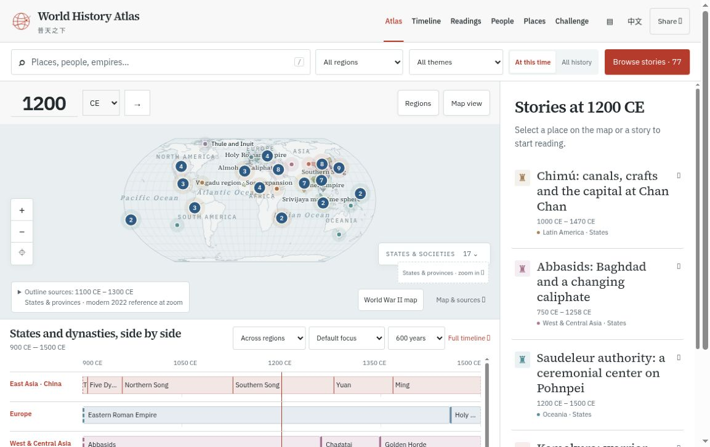

# 普天之下 · World History Atlas

**把故事放回当时的世界。**

一份中英双语历史地图，帮助你了解同一时期世界各地发生的事。沿着地图、时间线和主题导读，探索人物、地点与故事之间的联系。

[**打开在线地图 →**](https://world-history-atlas-guide.web.app/) · [English](README.md) · [致谢与来源](ACKNOWLEDGEMENTS.md) · [参与贡献](CONTRIBUTING.md)

[](https://world-history-atlas-guide.web.app/)

*2026年11月11日在线界面截图（英文）。以地图为中心，采用浅色底色与红色点缀，将故事卡片和区域时间线放在地图旁，便于对照阅读。*

## 可以怎样探索

- **看看同一时期的世界。** 选择年份，按地区和主题搜索，并列比较各地的国家与王朝。
- **沿着人物与地点读历史。** 浏览人物生平和地点资料，在地图上追踪有年代记录的事件。
- **用中文或英文阅读。** 跟随短篇导读，也可以分章探索较长的主题序列。
- **查看图像与证据。** 精选肖像、实物和文献图像均附图像年代、来源链接及各自的使用条件。
- **留下自己的笔记。** 在浏览器中收藏条目、记录想法，再导出笔记本。

内容仍在持续扩充，目前为选择性收录。历史地图有各自的年代和适用范围；地图上的空白不表示那里没有人或没有历史。

## 开发近况 · 2026年11月

**当前里程碑：V18 / 0.24.0。** 内容包括 **2,087 条历史记录、278 篇人物生平和 103 篇主题导读**。**540 幅注明出处的图像覆盖 985 条记录（47.2%）**，支持图像细看、并排比较，以及 21 组图像对读。人物目录默认展示已有肖像或相关作品，不排除暂无配图的人物。战时地图来源说明展开后，也不会遮住地图操作按钮。

**继续扩充：** 目标是至少半数条目拥有有意义的配图，即当前 2,087 条中的 1,044 条，尚需增加 59 条。[里程碑检查与上线状态](docs/V18_CHECKPOINT_985.md) · [图像覆盖清单](dist/data/visual-coverage-v18.json) · [开发记录](docs/V18_VISUAL_EXPANSION.md)。

Firebase 是主要在线地址。旧的 [GitHub Pages](https://haitaowu12.github.io/world-history-atlas/) 和 GPT Site 链接可能仍显示较早版本。2026年11月暂停使用 GitHub Actions；12月前不要触发或重试工作流。

## 为什么做这个项目

最初是想给女儿讲历史故事。我希望用中文和英文，把那个时代的人怎样生活、世界其他地方同时发生着什么，一起讲给她听，让她认识更广阔的世界，也与自己的中华文化保持联系。

DeanChensj 和贡献者们的[江山时序（Jiangshan Map）](https://github.com/DeanChensj/jiangshan-map)让我看到了实现这个想法的具体方式。在 OpenAI Codex 的帮助下，我做出了普天之下，希望与其他家长、学习者，以及喜欢把历史放回更大背景中理解的人分享。

Tony Wu

## 来源与致谢

特别感谢 **DeanChensj 和江山时序的贡献者们**。他们的工作不仅提供了灵感；本项目也使用并改编了注明归属的江山叙述、翻译、地名资料和人物纪事。普天之下独立维护，也欢迎探索[江山时序原版地图](https://deanchen.me/jiangshan-map/)。

[致谢与来源](ACKNOWLEDGEMENTS.md)列出了地图背后的项目、地图作者、数据提供者和资料机构。欢迎历史纠错，以及来自不同地区的观点。

## 本地运行

需要 Node.js 22 或更新版本及 Python 3，无需安装依赖或编译应用。

```sh
git clone https://github.com/haitaowu12/world-history-atlas.git
cd world-history-atlas
npm run serve
```

打开 http://127.0.0.1:8080。运行 `npm run check` 检查应用和数据。仓库中已提交的 `dist/` 目录即为静态应用。

## 参与贡献与内容使用

欢迎通过 [GitHub Issues](https://github.com/haitaowu12/world-history-atlas/issues) 提交历史纠错、翻译建议或使用问题。历史纠错请附条目链接或标题，以及支持修正的来源。修改资料前请阅读[贡献指南](CONTRIBUTING.md)和[数据政策](docs/DATA_POLICY.md)。

原创应用代码和项目文档采用 [MIT](LICENSE)，原创历史叙述和教学内容采用 [CC BY 4.0](docs/CONTENT_LICENSE.md)。导入材料与依赖保留各自的声明；图像另有[逐文件署名与使用条件](dist/assets/history-media/NOTICE.md)。本仓库包含多种许可，MIT 和 CC BY 均不覆盖全部文件。

作者：[Tony Wu](https://tony-wu-home.web.app/) · [更多项目](https://tony-wu-home.web.app/#work)
