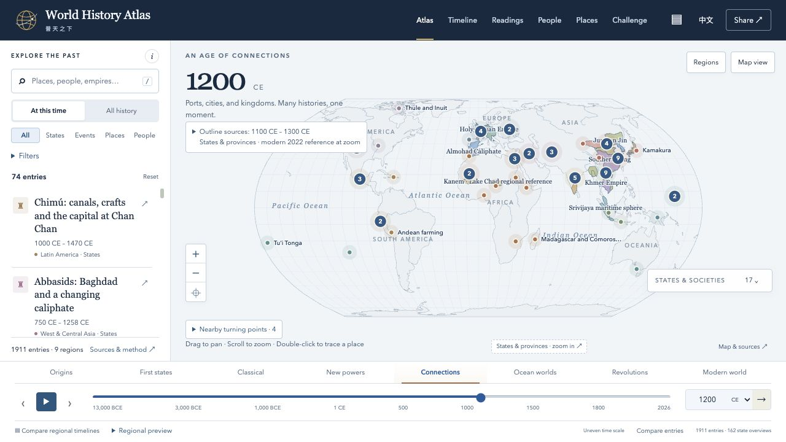

# 普天之下 · World History Atlas

**把故事放回当时的世界。**

[打开地图](https://world-history-atlas-guide.web.app) · [GitHub Pages 镜像](https://haitaowu12.github.io/world-history-atlas/) · [English](README.md) · [致谢与来源](ACKNOWLEDGEMENTS.md) · [参与贡献](CONTRIBUTING.md)



## 为什么做这个项目

最初只是想给女儿讲历史故事。我常常觉得，一个故事讲完了，却还缺少一些背景：那个时代的人怎样生活？同一时期，世界其他地方又在发生什么？每次讲一个事件，或解释一件文物，我都想把这些联系也讲给她听。

这件事我已经自己摸索了一段时间。我也希望能用中文和英文一起讲，让她认识更广阔的世界，同时与自己的中华文化保持联系，并为自己的文化传承感到自豪。

后来，我偶然发现了 DeanChensj 和贡献者们的[江山时序（Jiangshan Map）](https://github.com/DeanChensj/jiangshan-map)。它把中国历史中的地点、事件和人物故事放在地图上，让我看到了实现这个想法的一种具体方式。

受到它的启发，在 OpenAI Codex 的帮助下，我做出了普天之下。很高兴能把它分享给其他家长、学习者，以及喜欢把历史放回更大背景中理解的人。

— [Tony Wu](https://tony-wu-home.web.app/)

## 可以怎样探索

- 拖动时间，结合地图对照各地精选政权时段；打开完整时间线，浏览已收录的国家与王朝。
- 探索人物、地点、事件和部分历史地图，阅读所引来源及年代与证据局限说明。
- 在中文和英文之间切换。
- 跟随短篇导读，或分章阅读较长的主题序列。
- 在浏览器中保存条目和个人笔记，并导出笔记本。

当前仓库版本为 **0.23.0**，包含 **2,084条历史记录、278篇完整人物生平和103篇主题阅读**。[发布证据记录](docs/V17_RELEASE_EVIDENCE.md)列出检查结果与上线状态；分支中的输出已准备，并不意味着Firebase网站已经更新。这是一个仍在成长、选择性收录内容的教育项目。地图有各自的来源年代与适用范围；空白并不表示那里没有人或没有历史。欢迎历史纠错、翻译建议，以及来自不同地区和社群的观点。

## 0.23.0的人物、劳动与相互联系的故事

- **为101则既有人物资料补充经查证的生平**，保留姓名、别名与链接。人物目录中的278位人物均有完整生平文章。六则资料附有专门的年代核查说明，解释为何证据支持的独立节点少于三个；不为填满时间线而编造日期。
- **新增47篇中英双语故事，涉及九个地区**，让工匠、家庭、劳动者、旅人和记录者进入地图。主题包括梅勒运石、埃奎亚诺的出版网络、桑奇施主、越南陶瓷船货、瓜伊哈纳斯的共同保护，以及太平洋的材料知识。
- **新增30篇主题阅读**，将新故事与既有人物、地点和事件相连。旧导读的标识、节点次序和分享链接保持不变。
- **新增13幅历史图像，总数达到29幅**。公共领域肖像、历史描绘及两幅大都会艺术博物馆CC0实物照片，均附双语说明、来源与逐文件使用条件；后世形象另有明确标注。
- **为新增内容提供双语地点和证据说明**，并为975则导入条目及149则较早的关联条目提供中文地点说明，保留已修订的地理限定语；地图、人物、参考资料和阅读目录的搜索可处理声调符号、重音、全角字符与连续空格。

[V17江山更新审阅](docs/JIANGSHAN_REVIEW_V17.md)检查了四个较新的提交，注明关联阅读与搜索一致性方法的启发，并区分已存在的功能。[水系及通道比对](docs/CH3_SOURCE_COMPARISON_V17.md)核对固定版本的源文件，同时保留历史证据与逐线权利仍待研究的事项。本次没有新导入江山代码、原文或地图几何。[路线图](docs/CONTENT_EXPANSION_PLAN.md)区分本次完成的发布范围与后续区域研究。

## 0.22.0的故事与图像

- **新增14篇中英双语故事：**六篇中国故事通过留存文字理解安史之乱，阅读苏轼的诗作与公共事务，并认识《永乐大典》。八篇世界故事涉及铜交易投诉、泥板食谱、面包与啤酒、称金砝码、玛雅可可杯、印加织衣、马绍尔航海图和汤加树皮布。
- **修订四篇既有中国故事：**泾原兵变、楚与荆南、九经雕版刊刻工程及盐铁之议，均补充了支持具体论述的证据，江山条目保留为选题来源。
- **加入16幅注明出处的本地历史图像：**包括十幅历史人物肖像或形象，以及六幅实物或手稿图像，配有双语说明、年代、表现局限和来源链接。各图的使用条件分别列于[图像声明](dist/assets/history-media/NOTICE.md)。

[11月9日江山更新审阅](docs/JIANGSHAN_REVIEW_2026_11_09.md)记录了该版本的所选主题、来源核对及暂缓内容。0.22.0以这些主题为线索，根据独立证据撰写原创叙述，没有新导入江山的代码、原文或地图几何。当时新增的三篇导读——**手中的历史**、**从留存文字看唐朝危机**及**书籍、诗作与公共事务**——继续保留。

## 致谢

特别感谢 **DeanChensj 和江山时序的贡献者们**。原项目不只提供了灵感；本项目也使用并改编了有明确归属的江山叙述、翻译、地名资料和人物纪事。欢迎也去探索[江山时序原版地图](https://deanchen.me/jiangshan-map/)。

普天之下由 Tony Wu 独立维护。[致谢与来源](ACKNOWLEDGEMENTS.md)列出了相关项目、地图作者、数据提供者和历史资料机构，并说明继承资料及其保留的来源声明。

## 本地运行与参与

需要 Node.js 22 或更新版本及 Python 3；无需安装依赖或编译应用。

```sh
git clone https://github.com/haitaowu12/world-history-atlas.git
cd world-history-atlas
npm run serve
```

打开 http://127.0.0.1:8080。运行 `npm run check` 检查应用和数据。

欢迎通过 [GitHub Issues](https://github.com/haitaowu12/world-history-atlas/issues) 提交历史纠错、翻译建议或使用问题。历史纠错请附上条目链接或标题，以及支持修正的来源。修改资料前请阅读[贡献指南](CONTRIBUTING.md)和[数据政策](docs/DATA_POLICY.md)。

原创代码和项目文档采用 [MIT](LICENSE)，原创历史叙述和教学内容采用 [CC BY 4.0](docs/CONTENT_LICENSE.md)。继承内容、地图、引文、翻译和依赖保留各自的声明；历史图像另有[逐文件署名与使用条件](dist/assets/history-media/NOTICE.md)。这两个项目许可均不覆盖仓库内全部材料。详见[致谢与来源](ACKNOWLEDGEMENTS.md)及[内容与第三方声明](docs/CONTENT_LICENSE.md)。
